# 架构设计及约束

> 模块：external_device_manager。源码路径相对仓根。

## 架构设计

### 设计原则

| 原则 | 描述 | 理由 |
|---|---|---|
| 分层单向依赖 | interfaces/（公共 API 与 IDL）→ frameworks/（客户端与 DDK 实现）→ services/（SA 实现）；interfaces/ 不反向依赖 | inner_kits 发布契约稳定（bundle.json build.inner_kits 仅 driver_ext_mgr_client.h）；由 bundle.json deps 与各 BUILD.gn 引用关系确认 |
| 总线扩展插件化 | 所有总线类型实现 `IBusExtension`（utils/include/ibus_extension.h:27），由 `BusExtensionCore` 以 dlopen 动态加载（bus_extension_core.cpp:52-78） | 新总线（HID/SCSI/Serial 等 DDK 场景）无需改 SA 主体即可接入；USB 目前是唯一注册的总线（busTypeMap_ 仅 "usb"→BUS_TYPE_USB，bus_extension_core.cpp:37-39） |
| IDL 单一真源 | IPC 方法以 interfaces/innerkits/IDriverExtMgr.idl 为源，stub/proxy 生成物不手改；IPC 码枚举 hdf_ext_devmgr_interface_code.h:23-32（QUERY_DEVICE=1 … NOTIFY_USB_PERIPHERAL_FAULT=8） | 线序协议跨版本兼容，重排即破坏（AGENTS.md 亦列为红线） |
| 按需加载与自回收 | SA 配置 `"ondemand": true`（sa_profile/hdf_ext_devmgr.cfg:22），设备全部移除后 30 秒定时卸载（etx_device_mgr.cpp:33 `UNLOAD_SA_TIMER_INTERVAL`、:486 `UnLoadSelf`） | 常驻内存换业务频率的取舍，735KB ROM/8000KB RAM（bundle.json） |
| 所有权分型 | C++ 对象用 shared_ptr/weak_ptr（如 `Device` 持 `enable_shared_from_this`，回调持 weak_ptr），IPC 远端对象用 sptr/wptr（如 `drvExtRemote_`、`IDriverExtMgrCallback`） | 跨进程生命周期的对象必须引用计数托管，death recipient 是唯一的远端死亡感知手段 |
| 可靠性优先于即时性 | 启动期 BMS 未就绪时 `Device::Connect()` 最多重试 30 次、每次 100ms（device.cpp:73-89）；SA 启动用 future 等待 BMS/账户/CES 就绪后再异步扫描（drv_bundle_state_callback.cpp:347-359） | 开机首插设备的可用性；重试参数为代码内常量 |

### 逻辑架构

> 下图组件标签为所属 package 目录内的相对路径（如 [src/...]、[include/...] 指 services/native/driver_extension_manager/ 下同名文件；[native/...]、[ddk/...]、[js/...] 指 frameworks/ 下对应子目录）。

```plantuml
@startuml
skinparam componentStyle rectangle
package "interfaces/（公共契约）" {
  [IDriverExtMgr.idl + IDriverExtMgrCallback.idl\n(生成 stub/proxy)]
  [driver_ext_mgr_types.h\nErrMsg/DeviceData/DeviceInfoData/DriverInfoData]
  [ddk/<bus>/<bus>_api.h + <bus>_types.h\nUSB/HID/SCSI/UsbSerial/Base C API]
}
package "frameworks/（进程内客户端）" {
  [native/driver_ext_mgr_client.cpp\nDriverExtMgrClient: 惰性连接+死亡通知]
  [ddk/usb/usb_ddk_api.cpp\ng_ddk=IUsbDdk V1_1]
  [ddk/base|hid|scsi|usb_serial/]
  [js/napi/device_manager/device_manager_middle.cpp\nJS API + DeviceManagerCallback]
  [js/ani + js/taihe（taihe_ffi_gen 生成，勿手改）]
}
package "services/native/driver_extension_manager/（SA 5110 主体）" {
  [src/driver_ext_mgr.cpp\nDriverExtMgr: OnStart 装配 + 8 个 IPC 方法]
  [src/device_manager/etx_device_mgr.cpp\nExtDeviceManager: deviceMap_/bundleMatchMap_]
  [src/device_manager/device.cpp\nDevice: 绑定 caller 与远端对象管理]
  [src/device_manager/driver_extension_controller.cpp\n经 AMS 连接/启停 DriverExtension]
  [src/drivers_pkg_manager/driver_pkg_manager.cpp + drv_bundle_state_callback.cpp\nBMS 元数据解析]
  [src/drivers_pkg_manager/pkg_db_helper.cpp + pkg_database.cpp\nRDB pkg.db]
  [src/bus_extension/core/bus_extension_core.cpp\nBusExtensionCore: dlopen/注册表]
  [src/ext_permission_manager.cpp\nAccessToken 校验]
  [src/drivers_hisysevent/driver_report_sys_event.cpp\nHiSysEvent 埋点]
  [src/event_config.cpp + src/device_notification/\n故障通知]
}
package "services/native/driver_extension/（Ability 侧框架）" {
  [driver_extension.cpp\nDriverExtension: ExtensionBase 子类]
  [js_driver_extension.cpp\nonInit/onConnect/onDisconnect/onRelease]
  [driver_extension_context.cpp + js_driver_extension_context.cpp\nUpdateDriverState]
}
package "运行时依赖" {
  [samgr] as samgr
  [BMS] as bms
  [AMS] as ams
  [usbd HDI\nIUsbHostInterface/IUsbInterface/IUsbDdk] as usbd
}
[frameworks] ..> [interfaces] : 编译依赖
[services] ..> [interfaces] : 实现契约
DriverExtMgr --> ExtDeviceManager : ConnectDevice/DisConnectDevice\nConnectDriverWithDeviceId
DriverExtMgr --> DriverPkgManager : QueryDriverInfo/QueryMatchDriver
DriverExtMgr --> ExtPermissionManager : VerifyPermission/GetCallingTokenID
ExtDeviceManager --> Device : 注册/匹配/连接
ExtDeviceManager --> DriverExtensionController : Device::Connect 内部转发
Device --> DriverExtensionController : ConnectDriverExtension
DriverExtensionController --> ams
DriverPkgManager --> bms
DriverPkgManager --> [RDB pkg.db]
BusExtensionCore --> usbd : 经 UsbBusExtension/UsbDevSubscriber
samgr .. DriverExtMgr : 发布 SA 5110
@enduml
```

调用链要点（输入→分发→处理→输出）：

1. **JS 查询**：`queryDevices`（device_manager_middle.cpp:984 注册）→ `DriverExtMgrClient::QueryDevice`（frameworks/native/driver_ext_mgr_client.cpp:136）→ IPC stub → `DriverExtMgr::QueryDevice`（src/driver_ext_mgr.cpp:136，先校验 `ohos.permission.ACCESS_EXTENSIONAL_DEVICE_DRIVER`）→ `ExtDeviceManager::QueryDevice(busType)`（etx_device_mgr.cpp:417）→ 装配 `USBDevice`（interfaces/innerkits/driver_ext_mgr_types.h:56）返回。
2. **热插拔**：`UsbDevSubscriber::DeviceEvent`（usb_dev_subscriber.cpp:232）→ `DevChangeCallback::OnDeviceAdd`（dev_change_callback.cpp:23）→ `ExtDeviceManager::RegisterDevice`（etx_device_mgr.cpp:315）→ `DriverPkgManager::QueryMatchDriver`（driver_pkg_manager.cpp:114）→ 命中则 `AddDevIdOfBundleInfoMap` + `Device::Connect()`（etx_device_mgr.cpp:108）；同时 `driverChangeCallback_->OnDriverMatched` → `UsbDriverChangeCallback` → `IUsbDdk::UpdateDriverInfo`。
3. **绑定**：`bindDevice` → `Device::Connect(callback, callingTokenId)`（device.cpp:96）→ 已有远端对象则立即回调；否则 `DriverExtensionController::ConnectDriverExtension`（driver_extension_controller.cpp:113）→ AMS `ConnectAbility` → 厂商 `JsDriverExtension::OnConnect`（js_driver_extension.cpp:267）返回远端对象 → `Device::OnConnect`（device.cpp:177）向所有 callbacks_ 分发。
4. **包更新**：`DrvBundleStateCallback::OnBundleUpdated`（drv_bundle_state_callback.cpp:245）→ `UpdateToRdb` → 线程内 `BundleUpdateCallback::OnBundlesUpdated`（bundle_update_callback.cpp:21）→ `DeleteBundlesOfBundleInfoMap` + `MatchDriverInfos`（etx_device_mgr.cpp:222/244）重新匹配。
5. **DDK 传输**：`OH_Usb_SendPipeRequest`（usb_ddk_api.cpp:431）→ `g_ddk->SendPipeRequest`（HDI IUsbDdk，进程内直连，不经 SA 5110）→ usbd 内核态执行。

### 非功能设计

| 场景类别 | 方案设计 |
|---|---|
| 启动时序 | SA OnStart 仅装配本地模块并 `Publish`；BMS/账户/公共事件服务就绪由 `OnAddSystemAbility` + `shared_future` 门控（driver_ext_mgr.cpp:97-134、drv_bundle_state_callback.cpp:347）；`initOnce` 标志保证全量 BMS 扫描仅一次（drv_bundle_state_callback.cpp:316-345） |
| 并发安全 | SA 为多线程（IPC 线程 + HDI 回调 + 包事件线程 + 定时器）。共享表各自配锁：`deviceMapMutex_`/`bundleMatchMapMutex_`（etx_device_mgr.h:74-75）、`Device::deviceMutex_` 为 recursive_mutex（device.h:179）、RDB 操作 `databaseMutex_`（pkg_db_helper.h:68）、BMS 代理 `bundleMgrMutex_`；`QueryDeviceByDeviceID` 在持 deviceMapMutex_ 的调用方上下文执行（etx_device_mgr.cpp:521） |
| 失败恢复 | BMS 代理死亡：`BundleMgrDeathRecipient` → `ResetBundleMgr` 重建代理（drv_bundle_state_callback.cpp:518/556）；非 pass-through 下 usbd 死亡：卸载自身 SA（usb_bus_extension.cpp:220-232）；客户端侧 SA 死亡：`DriverExtMgrDeathRecipient` 清空 proxy（driver_ext_mgr_client.cpp:121-134） |
| 资源安全 | DDK 层 fd/mmap 以 `g_fdMap`/`g_bufferSizeMap` 登记，Release 时统一 close/munmap（usb_ddk_api.cpp:50-56、137-150）；配置描述符需配对 `OH_Usb_GetConfigDescriptor`/`OH_Usb_FreeConfigDescriptor`（usb_ddk_api.h:90-114）；`EmulatorNotSupported` 前置守卫（utils/include/ddk_emulator_utils.h） |
| 观测性 | 全链路 EDM_LOG*（domain 0xD002550，utils/include/hilog_wrapper.h:46）；关键业务动作落 HiSysEvent（hisysevent.yaml 4 事件，snNum 仅上报末 5 位，driver_report_sys_event.cpp:29/70-71）；`ExtDevApiMetrics`（frameworks/js/napi 引用 ext_dev_api_metrics.h）在 extdevmgr_feature_metrics_enable 时启用（extdevmgr.gni:31-33） |
| 隐私与安全 | SA 以 hdf_ext_devmgr UID、system_basic APL、SELinux u:r:hdf_ext_devmgr:s0 运行（sa_profile/hdf_ext_devmgr.cfg:43-45）；日志不落敏感值（serial 号仅在埋点中截断）；DDK 权限在 HDI 服务侧按调用方 token 校验 |
| 兼容性 | `min_hdi_proxy_version` 锁定 libusb_proxy_2.0.z.so / libusb_ddk_proxy_1.2.z.so（sa_profile/5110.json:11）；DDK 头文件 @since 10/12/14/16/26 分版本演进（如 usb_ddk_api.h:27、ddk_api.h:25） |

### 构建与特性开关

- 组件为 `external_device_manager`（subsystem hdf，bundle.json:13-14）；6 个 SysCap 对应 5 组 DDK + 整体扩展能力（bundle.json:15-22）。
- `extdevmgr.gni:19-29` 开关：`extdevmgr_usb_pass_through`（默认 true，决定 USB 代理 2.0 走 `IUsbHostInterface`("usb_host_interface_service") 还是 1.0 走 `IUsbInterface`，usb_bus_extension.cpp:34/96-144）、`external_device_manager_enable_service`（false 时 DDK/NAPI/客户端全部退化为 SERVICE_EXCEPTION=22900001，driver_ext_mgr_client.cpp:23-25）、`external_device_manager_enable_app_launch`（默认 false，`ENABLE_APP_LAUNCH_MANAGER` 编译开关）、`extdevmgr_feature_metrics_enable`（随 hiviewdfx_api_metrics 存在自动置 true）。
- 构建产物（bundle.json:73-82）：`libdriver_extension_manager.z.so`（SA）、`driver_extension_module`（Ability 框架）、`libdriver_extension_usb_bus.z.so`（总线插件）、`ext_devmgr_frameworks`、`drivers_pkg_manager`、`driver_extension_device_manager`、`driver_extension_bus_core`、`report_sys_event`。

## 架构约束

- **IDL 是 IPC 唯一真源**
  - **what**：增删改 SA 方法只能改 interfaces/innerkits/IDriverExtMgr.idl 并重新生成 stub/proxy；`DriverExtMgrInterfaceCode`（hdf_ext_devmgr_interface_code.h:22-32）1-8 不可重排重编。
  - **why**：线序协议，跨版本（新老系统混部）下码值漂移将导致方法错位调用。
- **总线能力只经 IBusExtension 暴露**
  - **what**：SA 内匹配（MatchDriver）、元数据解析（ParseDriverInfo）、设备回调（SetDevChangeCallback/AcquireDriverChangeCallback）一律通过 `BusExtensionCore::GetBusExtensionByName` 获取插件实例（utils/include/ibus_extension.h:27-36），SA 主体不出现 USB 专属类型。
  - **why**：新总线接入时零侵入 SA；破坏该边界会把总线语义焊死在核心流程里。
- **deviceId 为 64 位联合体编码**
  - **what**：`DeviceInfo::devInfo_` 是 `{uint64_t deviceId} ∪ {BusType busType; uint32_t busDeviceId}` 联合体（utils/include/ext_object.h:146-152），USB busDeviceId = (busNum << 16) + devAddr（usb_dev_subscriber.cpp:54-58）；`QueryDeviceByDeviceID` 直接把低 32 位 reinterpreted 为 busType（etx_device_mgr.cpp:521-523）。DDK 侧另有 64 位 deviceId = (busNum << 32) + devAddr（ToDdkDeviceId，usb_dev_subscriber.cpp:60-63），两者不可混用。
  - **why**：一套 uint64 key 同时承载总线区分与定位；混用两套编码将查不到设备或跨总线串号。
- **layering 依赖方向不可反转**
  - **what**：interfaces/ 不得 include services/ 或 frameworks/ 内容；services/ 与 frameworks/ 公共类型下沉 utils/include/（ext_object.h、ibus_extension.h 等）。
  - **why**：inner_kits 对外发布，反向依赖将把实现细节带进发布面。
- **生成代码不手改**
  - **what**：IDL 生成的 driver_ext_mgr_stub/proxy、callback stub，以及 frameworks/js/ani、frameworks/js/taihe（taihe_ffi_gen 生成）均不可直接编辑。
  - **why**：下次生成覆盖手改，且 ANI/NAPI 两套绑定必须保持同一 API 面。
- **SA 身份与数据路径固定**
  - **what**：UID/GID、APL system_basic、SELinux 标签（sa_profile/hdf_ext_devmgr.cfg）、RDB 路径 /data/service/el1/public/pkg_service/pkg.db（由 cfg 的 init job 预建目录，hdf_ext_devmgr.cfg:12-16）不可变更。
  - **why**：SELinux 策略与目录属主随镜像发布，漂移即读写失败或安全缺口。
