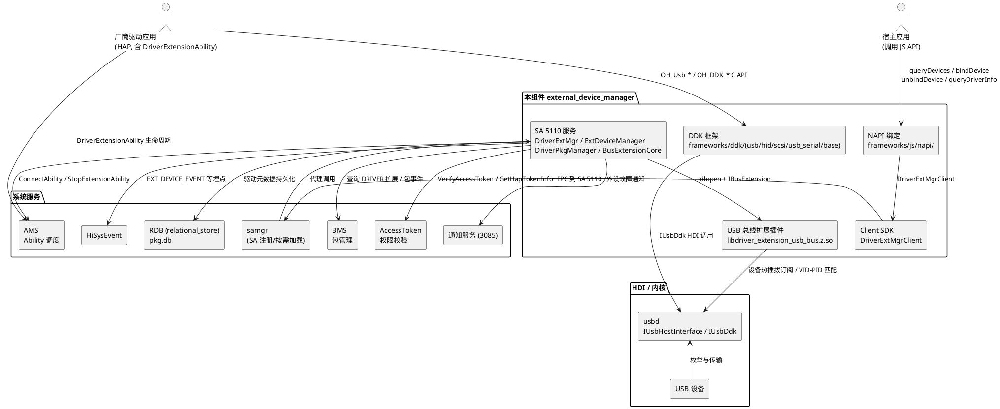

# 业务背景

> 模块：external_device_manager（@ohos/external_device_manager，HDF 子系统，SA 5110，进程 hdf_ext_devmgr）
> 源码依据：bundle.json、sa_profile/、services/、frameworks/、interfaces/、utils/，路径均相对仓根。

## 应用定位

### 核心职责

外部设备驱动框架（External Device Driver Framework），面向"外设驱动以应用形态分发"的业务问题，承担四类职责：

| 职责 | 说明 | 主要入口 |
|---|---|---|
| 外设驱动包管理 | 监听驱动类 HAP 的安装/更新/卸载，解析 module.json5 中的 DRIVER 扩展元数据（bus、vid、pid 等）并持久化 | `DriverPkgManager`、`DrvBundleStateCallback`（services/native/driver_extension_manager/src/drivers_pkg_manager/） |
| 设备-驱动匹配与绑定 | 对热插拔设备按 VID/PID 匹配驱动，按需拉起/停止 DriverExtensionAbility，并维护应用与驱动的绑定关系 | `ExtDeviceManager`（services/native/driver_extension_manager/src/device_manager/etx_device_mgr.cpp）、`UsbBusExtension::MatchDriver`（services/native/driver_extension_manager/src/bus_extension/usb/usb_bus_extension.cpp:148） |
| 设备查询与驱动查询 API | 对外提供 QueryDevice/BindDevice/UnBindDevice/QueryDeviceInfo/QueryDriverInfo/BindDriverWithDeviceId/UnBindDriverWithDeviceId/NotifyUsbPeripheralFault 八个 SA 方法 | `DriverExtMgr`（services/native/driver_extension_manager/src/driver_ext_mgr.cpp）、IDL：interfaces/innerkits/IDriverExtMgr.idl |
| DDK C API | 面向设备厂商应用提供 USB/HID/SCSI/UsbSerial/Base 五组用户态 C 接口（接口在 interfaces/ddk/，实现在 frameworks/ddk/） | 如 `OH_Usb_Init`（frameworks/ddk/usb/usb_ddk_api.cpp:81）、`OH_DDK_CreateAshmem`（frameworks/ddk/base/） |

### 职责边界（本组件不负责）

- **USB 总线枚举与设备访问**：由 HDI 侧 usbd（drivers_interface_usb 的 `IUsbHostInterface`/`IUsbInterface`/`IUsbDdk`）承担，本组件只订阅事件并转发请求。
- **HAP 安装与包信息查询**：由 Bundle Manager Service（BMS）承担，本组件通过 `bundleMgr_->QueryExtensionAbilityInfos(ExtensionAbilityType::DRIVER, ...)` 获取（drv_bundle_state_callback.cpp:337）。
- **Ability 生命周期调度**：由 Ability Manager Service（AMS）承担，本组件仅通过 `AAFwk::AbilityManagerClient` 发起 Connect/Start/Stop（driver_extension_controller.cpp:68-189）。
- **内核驱动、文件系统、外设供电**：不涉及；DDK 全部走用户态 HDI 通道。
- **权限授予本身**：由 access_token 子系统承担，本组件只做校验（`ExtPermissionManager::VerifyPermission`，ext_permission_manager.cpp:43）。

## 系统上下文

## 核心输入

| 输入类型 | 来源 | 主要内容 | 触发时机 |
|---|---|---|---|
| IPC 接口调用 | NAPI/inner_kits 客户端经 `DriverExtMgrClient` | 8 个方法（见 interfaces/innerkits/IDriverExtMgr.idl），busType、deviceId、connectCallback | 应用调用 JS API（`@ohos.deviceManager`）时 |
| USB 设备热插拔 | usbd HDI 订阅（`BindUsbdHostSubscriber`，usb_bus_extension.cpp:141） | `UsbDevSubscriber::DeviceEvent` 的 status：0=上线、1=下线（usb_dev_subscriber.cpp:31-32） | 设备插拔即刻 |
| 包状态公共事件 | `BundleMonitor` 订阅 COMMON_EVENT_PACKAGE_ADDED/CHANGED/REMOVED（driver_pkg_manager.cpp:202-204） | bundleName、userId | 驱动包安装/更新/卸载 |
| 账户切换事件 | `OsAccountManager::SubscribeOsAccount` SWITCHING/SWITCHED（driver_pkg_manager.cpp:91-112） | 账户 localId | 多用户切换 |
| 驱动包元数据 | BMS `QueryExtensionAbilityInfos(ExtensionAbilityType::DRIVER)` | module.json5 metadata：bus、vendor、description、launchonbind、ohos.permission.ACCESS_DDK_ALLOWED、vid、pid | 启动扫描与包事件 |
| SA 就绪事件 | `OnAddSystemAbility`：BMS / 账户 / CES（driver_ext_mgr.cpp:97-134） | systemAbilityId | 按需启动依赖服务上线时 |

## 核心输出

| 输出类型 | 接收方 | 业务作用 |
|---|---|---|
| 设备列表/设备信息/驱动信息 | 调用应用（JS 侧转换为 Array\<Device\> 等结构） | 设备发现、驱动详情展示；`QueryDeviceInfo` 额外返回 isDriverMatched/driverUid（driver_ext_mgr_types.h:68-103） |
| 驱动绑定结果回调 | 绑定应用的 `IDriverExtMgrCallback::OnConnect/OnUnBind/OnDisconnect`（interfaces/innerkits/IDriverExtMgrCallback.idl） | 交付 DriverExtensionAbility 的远端对象，应用据此与驱动通信 |
| Ability 拉起/停止指令 | AMS（`ConnectAbility`/`StopExtensionAbility`，driver_extension_controller.cpp:145/105） | 驱动实例生命周期受设备在位与绑定关系驱动 |
| 驱动信息同步 | usbd HDI `IUsbDdk::UpdateDriverInfo/RemoveDriverInfo`（usb_driver_change_callback.cpp:41/54） | 把 driverUid/vids 下发 HDI，支撑 DDK 设备归属与访问控制 |
| 持久化记录 | RDB `pkg.db` 的 `pkgInfoTable` 表（pkg_database.h:38-46） | 重启后恢复驱动目录，路径 /data/service/el1/public/pkg_service/ |
| 观测事件 | HiSysEvent 域 EXTERNAL_DEVICE 的 4 个事件（hisysevent.yaml） | 事件含设备/驱动标识与错误码，供 hiview 消费 |
| 故障通知 | 通知服务（SA 3085），带 WantAgent 跳转 URI（notification_peripheral.cpp:36-40） | 外设故障对用户的可见提示 |
| SA 自卸载指令 | samgr `UnloadSystemAbility(5110)`（etx_device_mgr.cpp:513，USB 非 pass-through 模式下 usbd 死亡时同样触发，usb_bus_extension.cpp:228） | 30 秒无设备时回收服务进程 |
