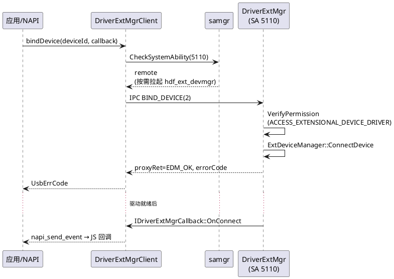
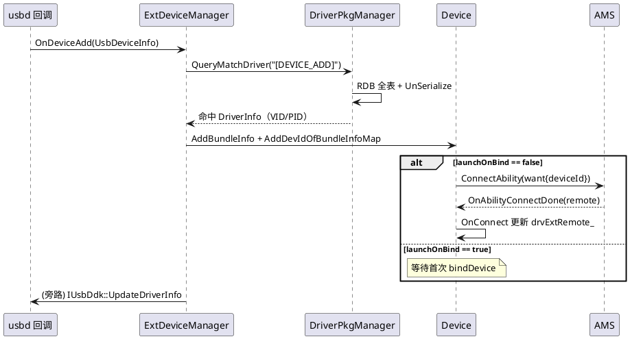

# 技术术语知识

external_device_manager 模块核心技术框架和机制的知识定义，涵盖价值认知、原理、使用方式和代码关联。路径相对仓根。

> 行号基线：commit 1412c92（2026-11-10 生成）；与代码不一致时以代码为准，溯源与刷新规则见 [README.md](README.md)。

## SA 服务与 IPC 接口机制（DriverExtMgr / SA 5110）

### 解决的问题（Problem）
| 子维度 | 内容 |
|---|---|
| 业务痛点 | 设备-驱动绑定是全局独占资源（一个 deviceId 只能由一个驱动扩展服务），且热插拔、包安装、多应用并发绑定必须集中裁决；无中心服务则各应用自行竞争设备 |
| 技术目标 | 以单一系统服务集中持有设备表与匹配表，向应用暴露稳定 IPC 契约，并支持按需启动以节省常驻内存 |

### 原理（Principles）
| 子维度 | 内容 |
|---|---|
| 核心机制 | `DriverExtMgr` 继承 SystemAbility(5110, supportDump=true)，经 `MakeAndRegisterAbility` 注册（services/native/driver_extension_manager/src/driver_ext_mgr.cpp:39-44）。OnStart 依序装配：LoadBusExtensionLibs → 取 USB driverChangeCallback → DriverPkgManager::Init(三个 future) → AddSystemAbilityListener(BMS/账户/CES) → ExtDeviceManager::Init → BusExtensionCore::Init(DevChangeCallback) → Publish → EventConfig 解析（driver_ext_mgr.cpp:47-82）。方法实现模式：入口权限校验 → 委托单例子模块 → 业务码写入 errorCode、IPC 层恒返回 EDM_OK |
| 关键流程 | 客户端 `DriverExtMgrClient::Connect`：CheckSystemAbility(5110)（不触发拉起）→ AddDeathRecipient → iface_cast\<IDriverExtMgr\>（frameworks/native/driver_ext_mgr_client.cpp:60-101）；调用后 ProxyRetTranslate 区分 IPC 错与业务错（driver_ext_mgr_client.cpp:42-58） |

### 使用方式（Usage）
| 子维度 | 内容 |
|---|---|
| 核心 API | 8 个 IDL 方法（interfaces/innerkits/IDriverExtMgr.idl:23-30）：QueryDevice(busType)、BindDevice(deviceId, callback)、UnBindDevice(deviceId)、BindDriverWithDeviceId、UnBindDriverWithDeviceId、QueryDeviceInfo(isByDeviceId, deviceId)、QueryDriverInfo(isByDriverUid, driverUid)、NotifyUsbPeripheralFault(domain, faultName)。C++ 侧经 `DriverExtMgrClient` 单例（interfaces/innerkits/driver_ext_mgr_client.h:25-39）；数据类型 ErrMsg/DeviceData/DeviceInfoData/DriverInfoData（driver_ext_mgr_types.h） |

### 代码关联（Code）
| 子维度 | 内容 |
|---|---|
| 核心类 | `DriverExtMgr`（services/native/driver_extension_manager/include/driver_ext_mgr.h + services/native/driver_extension_manager/src/driver_ext_mgr.cpp）、`DriverExtMgrClient`（frameworks/native/） |
| 核心成员 | 权限常量 PERMISSION_NAME/ACCESS_DDK_DRIVERS_PERMISSION（driver_ext_mgr.cpp:41-42）、bms/account/commEvent 三个 promise+future（driver_ext_mgr.h） |
| 核心方法 | `OnStart`/`OnAddSystemAbility`（driver_ext_mgr.cpp:47/97）、`QueryDevice`:136、`BindDevice`:175、`BindDriverWithDeviceId`:211、`QueryDeviceInfo`:333、`QueryDriverInfo`:366、`NotifyUsbPeripheralFault`:400 |

### 约束与限制（Constraints）
| 子维度 | 内容 |
|---|---|
| 系统限制 | IPC 码 1-8 线序契约（hdf_ext_devmgr_interface_code.h:23-30）不可重排；服务关闭编译态（external_device_manager_enable_service=false）时客户端全部返回 22900001（driver_ext_mgr_client.cpp:23-25） |
| 并发约束 | SA 多线程入口；OnAddSystemAbility 用 promiseMutex_ 保证 future 只置值一次（driver_ext_mgr.cpp:100、104/112/125） |
| 安全约束 | 全方法先权限校验；QueryDeviceInfo/QueryDriverInfo/NotifyUsbPeripheralFault 追加 IsSystemAppOrSa（driver_ext_mgr.cpp:337/369/402） |

## 总线扩展插件机制（BusExtensionCore / IBusExtension）

### 解决的问题（Problem）
| 子维度 | 内容 |
|---|---|
| 业务痛点 | 不同总线的"驱动元数据格式、匹配规则、设备事件来源"互不相同，若耦合在 SA 主体，每加一种总线都要改核心代码 |
| 技术目标 | 总线语义解耦为运行时加载的插件，SA 主体只面向 IBusExtension 抽象编程 |

### 原理（Principles）
| 子维度 | 内容 |
|---|---|
| 核心机制 | 插件 .so 放 /system/lib(64)/（aarch64 判定见 bus_extension_core.cpp:24-28），`LoadBusExtensionLibs` 以 realpath+dlopen(RTLD_LAZY) 装载（bus_extension_core.cpp:52-78）；插件 .so 内 `__attribute__((constructor))` 调 `RegisterBusExtension<T>(BUS_TYPE_*)` 完成自注册（usb_bus_extension.cpp:240-244）；BusExtensionCore 维护 busExtensions_（Register 带容量上限与幂等，bus_extension_core.cpp:93-106）与 busTypeMap_ 字符串映射（bus_extension_core.cpp:37-39） |
| 关键流程 | SA 启动 dlopen → 插件构造函数注册 → 业务侧 GetBusExtensionByName(busName) → LowerStr → busType → 插件实例（bus_extension_core.cpp:118-130）。元数据解析与反序列化都经此路由（drv_bundle_state_callback.cpp:121、driver_info.cpp:124） |

### 使用方式（Usage）
| 子维度 | 内容 |
|---|---|
| 核心 API | `IBusExtension` 五接口（utils/include/ibus_extension.h:30-35）：ParseDriverInfo/GetNewDriverInfoExtObject/MatchDriver/SetDevChangeCallback/AcquireDriverChangeCallback + GetBusType。新增总线 = 新 .so + 新 BusType 枚举 + busTypeMap_ 登记（注意 ext_object.h:23-28 的 BUS_TYPE_MAX 顺序约束） |

### 代码关联（Code）
| 子维度 | 内容 |
|---|---|
| 核心类 | `BusExtensionCore`（services/native/driver_extension_manager/include/bus_extension/core/bus_extension_core.h）、`UsbBusExtension`（services/native/driver_extension_manager/include/bus_extension/usb/usb_bus_extension.h） |
| 核心成员 | handleArr（dlopen 句柄，析构统一 dlclose，bus_extension_core.cpp:41-50）、busExtensions_/busTypeMap_ |
| 核心方法 | `LoadBusExtensionLibs`:52、`Init`:80（向各插件下发 DevChangeCallback）、`Register`:93、`GetBusTypeByName`:108、`AcquireDriverChangeCallback`:132 |

### 约束与限制（Constraints）
| 子维度 | 内容 |
|---|---|
| 系统限制 | 仅标准系统（adapted_system_type standard，bundle.json:30-32）；.so 命名前缀 lib + 固定名 + .z.so（bus_extension_core.cpp:29-31） |
| 并发约束 | 插件注册发生在 dlopen 阶段（OnStart 单线程内），运行期 busExtensions_ 只读 |
| 安全约束 | realpath 防 .so 路径逃逸（bus_extension_core.cpp:66-70）；当前总线集仅 "usb"（新总线接入需 bundle.json SysCap 等配套，属需评审变更） |

## USB 热插拔感知与设备信息采集机制（UsbDevSubscriber）

### 解决的问题（Problem）
| 子维度 | 内容 |
|---|---|
| 业务痛点 | SA 自身看不到总线事件；且设备身份（VID/PID/序列号/接口描述符）必须在注册前采集完整，否则匹配与展示缺失 |
| 技术目标 | 以 HDI 订阅获得上下线事件，并在上线瞬间完成描述符级信息采集后才开始匹配 |

### 原理（Principles）
| 子维度 | 内容 |
|---|---|
| 核心机制 | `UsbBusExtension::SetDevChangeCallback` 取 HDI 接口（pass-through：IUsbHostInterface::Get("usb_host_interface_service")；否则 IUsbInterface::Get() + 死亡监听，usb_bus_extension.cpp:96-144），创建 `UsbDevSubscriber` 并 Bind(Host)Subscriber（usb_bus_extension.cpp:141-144）。Subscriber 实现 usbd 回调接口：DeviceEvent 按 status 分派（0=上线/1=下线，usb_dev_subscriber.cpp:31-32/232-245） |
| 关键流程 | 上线：OpenDevice → GetDeviceDescriptor（长度须为 0x12，usb_dev_subscriber.cpp:35/145-159）→ 根 HUB 过滤（usb_dev_subscriber.cpp:39-40/188-192）→ 构造 UsbDeviceInfo（描述串 "USB&BUS_%02X&DEV_%02X&PID_%04X&VID_%04X&CLASS_%02X"，usb_dev_subscriber.cpp:42-52）→ GetDevStringVal 读序列号（宽字符转换，usb_dev_subscriber.cpp:252-290）→ GetConfigDescriptor(V1_2 IUsbDdk)+ParseUsbConfigDescriptor 得接口列表（usb_dev_subscriber.cpp:99-143）→ CloseDevice → OnDeviceAdd（usb_dev_subscriber.cpp:161-214）。全程失败即埋点（GET_DEVICE_DESCRIPTOR_FAILED 等） |

### 使用方式（Usage）
| 子维度 | 内容 |
|---|---|
| 核心 API | 无对外 API；内部入口 `UsbDevSubscriber::Init(callback, iusb, iUsbDdk)`（usb_dev_subscriber.cpp:82-97）。事件消费方固定为 `DevChangeCallback`（services/native/driver_extension_manager/src/device_manager/dev_change_callback.cpp:23-33）转发 ExtDeviceManager |

### 代码关联（Code）
| 子维度 | 内容 |
|---|---|
| 核心类 | `UsbDevSubscriber`（services/native/driver_extension_manager/include/bus_extension/usb/usb_dev_subscriber.h）、`DevChangeCallback`（services/native/driver_extension_manager/include/device_manager/dev_change_callback.h） |
| 核心成员 | callback_（IDevChangeCallback）、iusb_、iUsbDdk_；编码函数 ToBusDeivceId/ToDdkDeviceId/ToExtDevId（usb_dev_subscriber.cpp:54-79） |
| 核心方法 | `DeviceEvent`:232、`OnDeviceConnect`:161、`OnDeviceDisconnect`:216、`GetInterfaceDescriptor`:99、`GetUsbDeviceDescriptor`:145、`GetDevStringVal`:252 |

### 约束与限制（Constraints）
| 子维度 | 内容 |
|---|---|
| 系统限制 | 描述符读取短暂 Open/Close 设备，依赖 usbd 可用；接口描述符走 IUsbDdk（须代理 1.2+，5110.json:11） |
| 并发约束 | usbd 回调线程直入 ExtDeviceManager（RegisterDevice 持锁执行），采集函数内不做长阻塞 |
| 安全约束 | 序列号仅上报末 5 位（driver_report_sys_event.cpp:70-72）；采集失败不注册设备但埋点留痕 |

## 设备-驱动匹配与驱动扩展生命周期机制（QueryMatchDriver / Connect / LAUNCH_ON_BIND）

### 解决的问题（Problem）
| 子维度 | 内容 |
|---|---|
| 业务痛点 | 设备插入时驱动可能尚未安装，驱动安装时设备可能早已在位；且多应用共享一个驱动扩展、驱动生死必须与设备在位和绑定关系一致 |
| 技术目标 | 匹配幂等可重入（双向补配）；驱动扩展的启停由明确规则决定，多 caller 只有最后一个解绑才真正停止 |

### 原理（Principles）
| 子维度 | 内容 |
|---|---|
| 核心机制 | 匹配入口两处：设备上线 RegisterDevice("[DEVICE_ADD]")、包事件后 MatchDriverInfos("[BUNDLE_UPDATE]")（etx_device_mgr.cpp:348/258）。`DriverPkgManager::QueryMatchDriver` 刷新 BMS 扫描 → QueryPkgInfos 全表 → 逐行 UnSerialize → 总线插件 MatchDriver（driver_pkg_manager.cpp:114-159）；USB 判定 VID∈vids_ 且 PID∈pids_（usb_bus_extension.cpp:148-180）。命中 → Device::AddBundleInfo + AddDevIdOfBundleInfoMap；未命中静默等待（etx_device_mgr.cpp:357-362）。驱动拉起规则：launchOnBind=false → 设备命中即 `Device::Connect()`（无回调、仅拉起，etx_device_mgr.cpp:103-116）；true → 首次 bindDevice 时拉起。停止规则：解绑时"launchOnBind && IsLastCaller"才 Disconnect（etx_device_mgr.cpp:575-582/636-643）；拔出/包删除经 OnDisconnect → StopDriverExtension（device.cpp:221） |
| 关键流程 | 无参 Connect 的开机重试：最多 30 次×100ms（BMS 未就绪场景，device.cpp:72-89）；OnConnect 广播所有 callbacks_ 并置 isBound；OnDisconnect 清 caller/callback/远端并 Stop |

### 使用方式（Usage）
| 子维度 | 内容 |
|---|---|
| 核心 API | 应用侧 bindDevice/unbindDevice（回调三联 OnConnect/OnUnBind/OnDisconnect）；驱动侧 bindDriverWithDeviceId/unbindDriverWithDeviceId（带 appIds ACL）。服务内部：RegisterDevice/UnRegisterDevice/MatchDriverInfos/ClearMatchedDrivers（etx_device_mgr.h:41-55） |

### 代码关联（Code）
| 子维度 | 内容 |
|---|---|
| 核心类 | `ExtDeviceManager`（单例）、`Device`、`DriverExtensionController` |
| 核心成员 | deviceMap_/bundleMatchMap_（etx_device_mgr.h:72-73）、Device::boundCallerInfos_/callbacks_/drvExtRemote_（device.h:181-185） |
| 核心方法 | `RegisterDevice`:315、`UnRegisterDevice`:376、`ConnectDevice`:542、`DisConnectDevice`:556、`ConnectDriverWithDeviceId`:585、`MatchDriverInfos`:244、`ClearMatchedDrivers`:277、`Device::Connect`:61/96、`Device::OnDisconnect`:197 |

### 约束与限制（Constraints）
| 子维度 | 内容 |
|---|---|
| 系统限制 | 匹配为首个命中即返回（driver_pkg_manager.cpp:148-153），多驱动命中同一设备时顺序敏感（RDB 行序）；ConnectAbility 为异步，OnConnect 时机不保证在 bindDevice 返回前 |
| 并发约束 | RegisterDevice/ConnectDevice 全程持 deviceMapMutex_；Device::OnConnect/OnDisconnect 持 recursive deviceMutex_ 与回调线程互斥 |
| 安全约束 | bindDriverWithDeviceId 路径须过 CheckAccessPermission（accessAllowed + appIdentifier ACL/自身，etx_device_mgr.cpp:651-700）；失败埋点 BIND_ACCESS_NOT_ALLOWED |

## 驱动包元数据解析与持久化机制（DrvBundleStateCallback / pkg.db）

### 解决的问题（Problem）
| 子维度 | 内容 |
|---|---|
| 业务痛点 | BMS 只给 ExtensionAbilityInfo 原始结构；驱动目录须跨 SA 重启存活，且包事件与账户切换需要确定性的刷新/清理语义 |
| 技术目标 | 将 metadata 规整为可持久化、可反序列化、可与总线插件协作的 DriverInfo/PkgInfoTable 行 |

### 原理（Principles）
| 子维度 | 内容 |
|---|---|
| 核心机制 | 解析：`QueryDriverInfos` 以 GET_BUNDLE_INFO_WITH_EXTENSION_ABILITY/APPLICATION/METADATA 三 flag 拉 BundleInfo 过滤 DRIVER 型（drv_bundle_state_callback.cpp:385-415）；`ChangeValue` 按键取 bus/vendor/description/launchonbind(忽略大小写)/ACCESS_DDK_ALLOWED（drv_bundle_state_callback.cpp:83-103）；`ParseDriverInfo`（总线插件）补 vids/pids；`CreatePkgInfoTable` 生成 driverUid=name+"-"+accessTokenId、bundleAbility，并经 AccessTokenKit 取 userId/appIndex（drv_bundle_state_callback.cpp:154-170）；`DriverInfo::Serialize` 组装 8 键 JSON（driver_info.cpp:24-54）。持久化：PkgDbHelper → PkgDataBase（RdbHelper，S1，pkg_database.cpp:27-42）；`AddOrUpdatePkgInfo` 支持按 bundleName 整包替换或全量写入。刷新触发：包事件 OnBundleAdded/Updated/Removed（校验 IsCurrentUserId）→ UpdateToRdb/OnBundleDrvRemoved → 异步线程回调 `BundleUpdateCallback::OnBundlesUpdated` → DeleteBundlesOfBundleInfoMap + MatchDriverInfos（bundle_update_callback.cpp:21-25）。账户切换：SWITCHING/SWITCHED 订阅（driver_pkg_manager.cpp:91-112）→ OnBundlesReseted → ClearMatchedDrivers（bundle_update_callback.cpp:27-30）。启动：GetAllDriverInfosAsync 等 bms/account future 后一次性全量扫描（initOnce 防重复，drv_bundle_state_callback.cpp:316-359） |
| 关键流程 | 更新语义：OnBundleUpdated 时若 DRIVER 扩展清空则按移除处理（drv_bundle_state_callback.cpp:265-269）；BMS 死亡经 BundleMgrDeathRecipient 重建代理（drv_bundle_state_callback.cpp:518-529/556-564） |

### 使用方式（Usage）
| 子维度 | 内容 |
|---|---|
| 核心 API | 内部机制，无对外 API。相关只读出口：QueryDriverInfo（按 driverUid 或全量）经 DriverExtMgr 暴露（driver_ext_mgr.cpp:366-397）；PkgDbHelper 查询族（pkg_db_helper.h:38-53） |

### 代码关联（Code）
| 子维度 | 内容 |
|---|---|
| 核心类 | `DriverPkgManager`（单例）、`DrvBundleStateCallback`、`PkgDbHelper`/`PkgDataBase`、`BundleUpdateCallback`、`BundleMonitor`（bundle_framework 提供） |
| 核心成员 | initOnce/initOnceMutex_、bundleMgr_/bmsDeathRecipient_/bundleMgrMutex_（drv_bundle_state_callback.h）、PkgDataBase::store_ |
| 核心方法 | `ParseToPkgInfoTables`:105、`CreatePkgInfoTable`:154、`UpdateToRdb`:456、`OnBundleAdded/Updated/Removed`:215/245/281、`GetAllDriverInfos`:316、`GetAllDriverInfosAsync`:347、`OnBundleDrvRemoved`:531 |

### 约束与限制（Constraints）
| 子维度 | 内容 |
|---|---|
| 系统限制 | RDB 路径与表结构（pkgInfoTable 8 列，pkg_database.h:38-46）跨版本持久，变更须迁移（AGENTS.md Ask-Before）；driverUid 含 accessTokenId，卸载重装会生成新行 |
| 并发约束 | RDB 单写者（databaseMutex_）；包事件回调线程与异步通知线程分离（pthread_setname_np 命名 BUNDLE_UPDATE_TASK_NAME 等，drv_bundle_state_callback.cpp:55-57） |
| 安全约束 | 服务须持 LISTEN_BUNDLE_CHANGE/GET_BUNDLE_INFO_PRIVILEGED（hdf_ext_devmgr.cfg:26/36）；CheckBundleMgrProxyPermission 校验系统 API 调用身份（drv_bundle_state_callback.cpp:366-383） |

## 权限与访问控制机制（ExtPermissionManager + appIdentifier ACL）

### 解决的问题（Problem）
| 子维度 | 内容 |
|---|---|
| 业务痛点 | bindDevice 面向普通授权应用即可，而 bindDriverWithDeviceId 是"任意应用直连厂商驱动"的系统级能力，需要比静态权限更细的授权面 |
| 技术目标 | 分层校验：静态权限 →（系统接口限定）→ 驱动声明允许 → 调用者属于驱动应用或 ACL 名单 |

### 原理（Principles）
| 子维度 | 内容 |
|---|---|
| 核心机制 | 第一层 `VerifyPermission`：AccessTokenKit::VerifyAccessToken(callingToken, name)（ext_permission_manager.cpp:43-52）。第二层 `IsSystemAppOrSa`：IsSystemAppByFullTokenID 或 TOKEN_NATIVE（ext_permission_manager.cpp:54-67）。第三层（bindDriverWithDeviceId）：`GetPermissionValues` 经 GetReqPermissionByName 取 ACCESS_DDK_DRIVERS 的 appIds 参数，JSON 解析为集合（ext_permission_manager.cpp:74-104）；`CheckAccessPermission` 依次判 driverInfo 非空 → IsAccessAllowed → BMS GetAppProvisionInfo(驱动 bundle) 取 appIdentifier → 自身放行（IsCallerMatchDriverApp，比对调用方 provision appIdentifier，etx_device_mgr.cpp:702-718）或 appIdentifier ∈ accessibleAppIds（etx_device_mgr.cpp:651-700） |

### 使用方式（Usage）
| 子维度 | 内容 |
|---|---|
| 核心 API | `ExtPermissionManager::VerifyPermission/IsSystemAppOrSa/GetCallingTokenID/GetPermissionValues/GetHapTokenInfo`（services/native/driver_extension_manager/include/ext_permission_manager.h）；调用方为 driver_ext_mgr.cpp 各入口（141/179/215/337/343/369/375/402） |

### 代码关联（Code）
| 子维度 | 内容 |
|---|---|
| 核心类 | `ExtPermissionManager`（静态工具类，services/native/driver_extension_manager/src/ext_permission_manager.cpp） |
| 核心成员 | 无状态；依赖 IPCSkeleton 取 calling token |
| 核心方法 | `VerifyPermission`:43、`IsSystemAppOrSa`:54、`GetPermissionValues`:74、`GetHapTokenInfo`:106 |

### 约束与限制（Constraints）
| 子维度 | 内容 |
|---|---|
| 系统限制 | appIds 参数格式 {"appIds":"id1,id2"}，逗号分隔且逐项 Trim（ext_permission_manager.cpp:97-101）；取值失败仅告警不拒绝（driver_ext_mgr.cpp:223-226，此时 ACL 为空集、仅自身可绑定） |
| 并发约束 | 无共享状态，线程安全 |
| 安全约束 | **禁止**移除/放宽任何校验（coding-standards 红线）；权限名拼写以 driver_ext_mgr.cpp:41-42 常量为准 |

## USB DDK 用户态访问机制（frameworks/ddk/usb）

### 解决的问题（Problem）
| 子维度 | 内容 |
|---|---|
| 业务痛点 | 厂商驱动应用需要以 C 接口做描述符读取、接口独占、控制/批量/中断传输与大缓冲零拷贝，而不应接触 HDI 类型系统 |
| 技术目标 | 提供 C ABI 稳定层：参数即结构体、返回码自体系（USB_DDK_*）、传输缓冲走共享内存，HDI 细节全部内化 |

### 原理（Principles）
| 子维度 | 内容 |
|---|---|
| 核心机制 | 进程级单例 g_ddk = IUsbDdk(V1_1)，OH_Usb_Init 时 Get()+Init（usb_ddk_api.cpp:96-111）；每次调用 GetDdk() 判空 → USB_DDK_INVALID_OPERATION；HDI 错误经 g_errorMap 映射（HDF_ERR_NOPERM→USB_DDK_NO_PERM 等，usb_ddk_api.cpp:38-49），未命中默认透传或 defaultCode（usb_ddk_api.cpp:69-79）。大缓冲：GetDeviceMemMapFd + ftruncate + mmap(PROT_READ\|WRITE, MAP_SHARED)，g_fdMap 登记防泄漏（usb_ddk_api.cpp:497-545）；Release/ReleaseResource 统一 close+munmap（usb_ddk_api.cpp:137-150/182-195）。版本演进：V1_2 能力（ControlTransfer/GetDevices/GetNonRootHubs 等）经 IUsbDdk::CastFrom 升版调用（usb_ddk_api.cpp:614-671） |
| 关键流程 | 控制读：SendControlReadRequest 以 vector 暂存 → 长度校验 → memcpy_s（usb_ddk_api.cpp:363-400）；管道传输：offset/bufferLength 边界校验后整段下发（usb_ddk_api.cpp:431-461）；Ashmem 变体把 fd+地址向量打包 UsbAshmem（usb_ddk_api.cpp:463-495）；配置描述符 GetConfigDescriptor → ParseUsbConfigDescriptor 组装可释放结构（usb_ddk_api.cpp:241-268，parser 在 frameworks/ddk/usb/usb_config_desc_parser.h） |

### 使用方式（Usage）
| 子维度 | 内容 |
|---|---|
| 核心 API | 头文件 interfaces/ddk/usb/usb_ddk_api.h（@since 10 起，26.0/26.1 扩展）：OH_Usb_Init/Release/ReleaseResource、GetDeviceDescriptor、Get/FreeConfigDescriptor、Claim/ReleaseInterface、Select/GetCurrentInterfaceSetting、SendControlRead/WriteRequest、SendPipeRequest(WithAshmem)、Create/DestroyDeviceMemMap、GetDevices、ControlTransfer、GetNonRootHubs、Create/DestroyDeviceMemBuffer、Write/ReadPipe。Base 层 OH_DDK_Create/Map/Unmap/DestroyAshmem（interfaces/ddk/base/ddk_api.h，@since 12）供跨 DDK 复用 |

### 代码关联（Code）
| 子维度 | 内容 |
|---|---|
| 核心类 | 匿名命名空间全局态（g_ddk/g_errorMap/g_fdMap/g_bufferSizeMap/g_initialized + 三把锁，usb_ddk_api.cpp:36-65）；`UsbDdkConfigDescriptor`（usb_ddk_types.h） |
| 核心成员 | g_lifecycleMutex/g_mutex/g_fdMapMutex（usb_ddk_api.cpp:51-53） |
| 核心方法 | `OH_Usb_Init`:81、`OH_Usb_Release`:117、`OH_Usb_ReleaseResource`:164、`OH_Usb_ClaimInterface`:282、`OH_Usb_SendPipeRequest`:431、`OH_Usb_CreateDeviceMemMap`:497、`OH_Usb_ControlTransfer`:614 |

### 约束与限制（Constraints）
| 子维度 | 内容 |
|---|---|
| 系统限制 | 须先 Init（INVALID_OPERATION 语义）；deviceId 使用 DDK 编码 (busNum\<\<32)+devAddr，与 SA 侧 64 位 deviceId 编码不同（usb_dev_subscriber.cpp:60-63 vs ext_object.h:146-152）；模拟器构建返回 DDK_EMULATOR_NOT_SUPPORT（usb_ddk_api.cpp:83） |
| 并发约束 | Init/Release 互斥（g_lifecycleMutex）；传输可并发（shared_lock 读 g_ddk）；fd 表写互斥 |
| 安全约束 | ohos.permission.ACCESS_DDK_USB 由 HDI 服务按调用进程校验（HDF_ERR_NOPERM → USB_DDK_NO_PERM）；缓冲生命周期由调用方负责，文档化配对释放要求（usb_ddk_api.h:90-114 等 @since 注释） |

## SA 自卸载与按需运行机制（on-demand + UnLoadSelf）

### 解决的问题（Problem）
| 子维度 | 内容 |
|---|---|
| 业务痛点 | 外设管理是低频业务，常驻进程浪费内存 |
| 技术目标 | 首请求拉起、无设备 30 秒自动退出，且卸载动作自身幂等安全 |

### 原理（Principles）
| 子维度 | 内容 |
|---|---|
| 核心机制 | init 侧 `"ondemand": true`（hdf_ext_devmgr.cfg:22）+ samgr 拉起。退出触发：`UnRegisterDevice` 后调 `UnLoadSelf`：注销旧 timer → 无设备（GetTotalDeviceNum==0）才 Setup 新 timer → 30 秒后任务里 CheckSystemAbility 仍存在才 UnloadSystemAbility(5110)（etx_device_mgr.cpp:486-519）。期间任何 RegisterDevice 会注销 timer（etx_device_mgr.cpp:355）。非 pass-through USB 下 usbd 死亡也触发卸载（usb_bus_extension.cpp:219-232） |
| 关键流程 | 30 秒窗口内设备回插：timer 注销，无卸载；卸载后客户端下次 CheckSystemAbility 由 samgr 重新拉起 |

### 使用方式（Usage）
| 子维度 | 内容 |
|---|---|
| 核心 API | 内部机制（Utils::Timer unloadSelftimer_，etx_device_mgr.h:76-77）；对外表现为 SA 生命周期，无调用接口 |

### 代码关联（Code）
| 子维度 | 内容 |
|---|---|
| 核心类 | `ExtDeviceManager`（timer 持有者） |
| 核心成员 | unloadSelftimer_ {"unLoadSelfTimer"}、unloadSelftimerId_、UNLOAD_SA_TIMER_INTERVAL=30*1000（etx_device_mgr.cpp:33） |
| 核心方法 | `UnLoadSelf`:486、`GetTotalDeviceNum`:471、析构注销（etx_device_mgr.cpp:37-41） |

### 约束与限制（Constraints）
| 子维度 | 内容 |
|---|---|
| 系统限制 | GetTotalDeviceNum 不加锁，只允许持 deviceMapMutex_ 的调用路径使用（etx_device_mgr.cpp:473 注释），否则计数竞态 |
| 并发约束 | timer 回调独立线程执行 samgr 调用，不持任何设备锁 |
| 安全约束 | 卸载仅作用于自身 SA；CheckSystemAbility 先行确认避免误卸载（etx_device_mgr.cpp:507-511） |

## 观测埋点机制（HiSysEvent EXTERNAL_DEVICE 域）

### 解决的问题（Problem）
| 子维度 | 内容 |
|---|---|
| 业务痛点 | 匹配失败、绑定失败、包数据库更新失败等业务错误在返回码之外需要可聚合的现场数据 |
| 技术目标 | 统一 schema 的 STATISTIC 事件，字段稳定可被 hiview 规则消费 |

### 原理（Principles）
| 子维度 | 内容 |
|---|---|
| 核心机制 | `ExtDevReportSysEvent` 静态类两步走：ParseToExtDevEvent 把 DeviceInfo/DriverInfo/PkgInfoTable 折叠进 ExtDevEvent（设备字段 + 驱动字段 + interfaceName/operatType），ReportExternalDeviceEvent 组装 17 字段 HiSysEventWrite（driver_report_sys_event.cpp:62-102/104-158）。错误语义集中在 EventErrCode 枚举 + ErrMsgs 文案表（driver_report_sys_event.cpp:31-60）。SN_NUM 截末 5 位（driver_report_sys_event.cpp:29/70-72）。另有 SA 事件（OnStart 失败等）与 DDK 事件、包周期事件，schema 全量见 hisysevent.yaml:16-63 |
| 关键流程 | 调用点覆盖：匹配（QueryMatchDriver 三种结局）、绑定/解绑全链（device.cpp 与 etx_device_mgr.cpp）、包刷新与删库（drv_bundle_state_callback.cpp:425-454）、设备采集失败（usb_dev_subscriber.cpp:161-214） |

### 使用方式（Usage）
| 子维度 | 内容 |
|---|---|
| 核心 API | `ExtDevReportSysEvent::ReportExternalDeviceEvent(event[, errCode])`、`ParseToExtDevEvent` 三个重载（services/native/driver_extension_manager/include/drivers_hisysevent/driver_report_sys_event.h）。新增埋点必须同步改 hisysevent.yaml（schema 契约） |

### 代码关联（Code）
| 子维度 | 内容 |
|---|---|
| 核心类 | `ExtDevReportSysEvent`、`ExtDevEvent` |
| 核心成员 | ErrMsgs（EventErrCode→message） |
| 核心方法 | `ReportExternalDeviceEvent`:62/88、`ParseToExtDevEvent`:104/127/153、`ParseIdVector`:160（vids/pids 逗号串） |

### 约束与限制（Constraints）
| 子维度 | 内容 |
|---|---|
| 系统限制 | 4 事件字段名/类型/等级不可变更（hisysevent.yaml 为发布契约）；STATISTIC 类型不携带恢复语义 |
| 并发约束 | 埋点在业务线程内同步写，无锁（HiSysEvent 自身线程安全） |
| 安全约束 | 序列号截断；不得新增明文敏感字段（token/完整 SN） |

## 外设故障通知机制（NotifyUsbPeripheralFault → EventConfig → DeviceNotification）

### 解决的问题（Problem）
| 子维度 | 内容 |
|---|---|
| 业务痛点 | 外设故障（如 USB 外设异常）只有系统内部错误码，用户无感知、也无引导入口 |
| 技术目标 | 把受控的故障名翻译成本地化通知，并携带跳转 URI；通知内容必须受产品配置（CCM）约束，防止任意文案下发 |

### 原理（Principles）
| 子维度 | 内容 |
|---|---|
| 核心机制 | 配置双源：/sys_prod/etc/peripheral/peripheral_fault_notifier_config.json（CCM，授权面）与 /system/etc/peripheral/ 同名（本地文案），`EventConfig::FillFaultsMap` 取交集且以 CCM 为准（event_config.cpp:20-23/142-183）。运行：NotifyUsbPeripheralFault（系统应用/SA 限定，driver_ext_mgr.cpp:400-426）→ GetFaultInfo(domain, faultName) 四字段齐备才放行 → `DeviceNotification::HandleNotification`：NotificationLocale 本地化 → 组装 NotificationRequest（SOCIAL_COMMUNICATION 槽、不可移除、creator=3085）→ WantAgent(ohos.want.action.viewData + uri) → 图标 system/etc/peripheral/resources/peripheral_fault_icon.png（notification_peripheral.cpp:36-40/48-108） |
| 关键流程 | 失败路径全部显式返回：配置缺失 EDM_ERR_INVALID_PARAM、通知失败 EDM_NOK（driver_ext_mgr.cpp:407-425） |

### 使用方式（Usage）
| 子维度 | 内容 |
|---|---|
| 核心 API | IDL 方法 NotifyUsbPeripheralFault(domain, faultName)（IPC 码 8）；内部 EventConfig::GetInstance()/GetFaultInfo、DeviceNotification::GetInstance()/HandleNotification（services/native/driver_extension_manager/include/event_config.h、services/native/driver_extension_manager/include/device_notification/notification_peripheral.h） |

### 代码关联（Code）
| 子维度 | 内容 |
|---|---|
| 核心类 | `EventConfig`（单例）、`DeviceNotification`（单例）、`NotificationLocale`（services/native/driver_extension_manager/src/device_notification/notification_locale.cpp，i18n） |
| 核心成员 | peripheralFaultsMap_（domain→vector\<FaultInfo\>，event_config.h:56）、iconPixelMap_ |
| 核心方法 | `EventConfig::ParseJsonFile`:185、`GetFaultInfo`:208、`DeviceNotification::HandleNotification`:48、`SetWantAgent`:92、`GetPixelMap`:110 |

### 约束与限制（Constraints）
| 子维度 | 内容 |
|---|---|
| 系统限制 | 仅 CCM∩local 的故障可通知（event_config.cpp:147-176 的过滤与告警）；通知服务 SA 3085 可用性依赖 |
| 并发约束 | EventConfig 单例懒初始化带 mutex_（event_config.h:57）；ParseJsonFile 在 OnStart 一次性完成 |
| 安全约束 | 调用方须系统应用/SA；通知槽与控制标志（NOTIFICATION_CONTROL_DIALOG_FLAG）固定，不可降级为普通可清理通知 |
